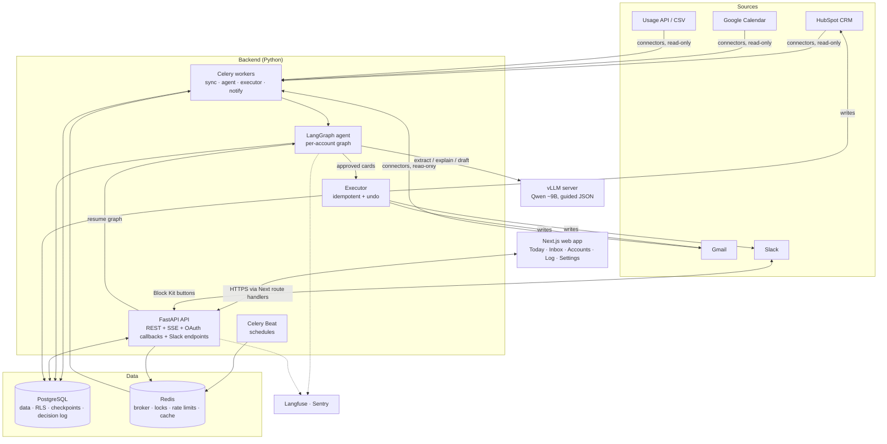
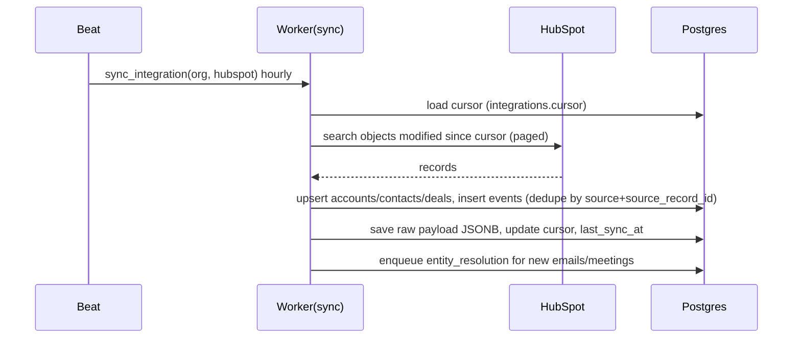

# systemdesign.md — System Design

> How the whole system fits together: components, data flow, runtime, storage, security, scaling, failure handling, deployment.
> Read `spec.md` first for the "what". Field-level details live in `backenddeveloper.md`, `frontenddeveloper.md`, `aiengineerhandover.md`.

---

## 1. Design principles (do not break these)

1. **AI reasons, plain code acts, humans approve.** The LLM never gets a write tool. Only the executor writes to external systems, and only for approved (or Tier 1) cards.
2. **No AI in ingestion.** Connectors are plain code. The model is used in exactly three places: signal extraction, explanation, action drafting.
3. **Every claim has evidence IDs**, validated by code.
4. **Tenant isolation in the database** (Postgres Row Level Security), not only in application code.
5. **Idempotent, reversible execution** (idempotency keys + pre-images).
6. **Untrusted text is data, never instructions** (emails, notes, transcripts).
7. **Monolith first.** One FastAPI app + one worker image + Postgres + Redis + model server. Split only when a real bottleneck appears.

## 2. High-level architecture



### Layers (same as pitch diagram)
| # | Layer | Components | Rule |
|---|---|---|---|
| 1 | Sources | HubSpot, Gmail, Calendar, Usage, Slack | External systems |
| 2 | Connectors + Timeline | `connectors/*`, `events`, `accounts`, `contacts`, `deals`, `usage_snapshots` | Read-only, no AI |
| 3 | Brain | Rules engine, LLM (extract/explain/draft), citation validator | AI only sees evidence we give it |
| 4 | Approval | Web inbox, Slack, LangGraph `interrupt()` | Human decides Tier 2 |
| 5 | Executor + Log | `executor/*`, `executions`, `decision_log` | Only writer to external systems |

## 3. Components

| Component | Tech | Responsibility | Scales by |
|---|---|---|---|
| **Web** | Next.js 15 (App Router), TypeScript, Tailwind, shadcn/ui, TanStack Query | UI; Auth.js session; proxies API calls via route handlers (adds service JWT) | Vercel / Node replicas |
| **API** | FastAPI, Pydantic v2, SQLAlchemy 2 async, asyncpg | REST `/api/v1`, SSE stream, OAuth callbacks, Slack events/interactions, ingest API | Uvicorn workers / replicas |
| **Workers** | Celery 5 + Redis broker | Queues: `sync`, `agent`, `executor`, `notify`, `default` | Worker count per queue |
| **Beat** | Celery Beat (single instance) | Schedules nightly runs, hourly syncs, digests, card expiry | 1 instance (use lock) |
| **Agent** | LangGraph + `PostgresSaver` (or `AsyncPostgresSaver`) checkpointer | Per-account graph with `interrupt()` for approval | Runs inside `agent` workers |
| **LLM server** | vLLM, OpenAI-compatible API, `guided_json` | Qwen ~9B inference | GPU count |
| **Database** | PostgreSQL 16 | All state, RLS, checkpoints, decision log | Vertical first, then read replica |
| **Redis** | Redis 7 | Broker, distributed locks, rate-limit buckets, Slack event dedupe, short cache | Single node (v1) |
| **Observability** | Langfuse (self-hosted), Sentry, JSON logs | Model traces, errors, logs | — |

## 4. Data flow

### 4.1 Sync (no AI)

- Gmail: `users.history.list` from stored `historyId`; full sync fallback if history expired.
- Calendar: `events.list` with `syncToken`; on 410 Gone → full resync.
- HubSpot: CRM Search API filtered by `hs_lastmodifieddate > cursor` (with 1-minute overlap), plus webhooks later.
- Usage: push via `POST /api/v1/ingest/usage` or CSV → `usage_snapshots`.

### 4.2 Detection + reasoning (per account)
```mermaid
sequenceDiagram
  participant Beat
  participant A as Worker(agent)
  participant DB as Postgres
  participant L as vLLM
  Beat->>A: nightly: enqueue run_account(org, account) for all active accounts
  A->>DB: load_evidence (events, usage, deals, contacts, signals)
  A->>L: extract_signals (only new emails/notes)
  L-->>A: JSON signals
  A->>DB: save signals
  A->>A: run_rules → rule_hits (code)
  alt no hits
    A->>DB: close run (no finding)
  else hits
    A->>A: build numbered evidence E1..En
    A->>L: explain (guided_json)
    L-->>A: claims with evidence_ids
    A->>A: validate citations (retry once)
    A->>L: draft actions
    A->>DB: upsert finding + action_cards (tiers from policy)
    A->>A: Tier 1 → executor; Tier 2 → interrupt()
  end
```

### 4.3 Approval + execution
```mermaid
sequenceDiagram
  participant U as User (Web/Slack)
  participant API
  participant G as LangGraph (agent worker)
  participant E as Executor
  participant X as HubSpot/Gmail/Slack
  participant DB as Postgres
  U->>API: POST /action-cards/{id}/approve (optional edited payload)
  API->>DB: card.status=approved, decision_log(approved)
  API->>G: enqueue resume(thread_id, Command(resume={decision}))
  G->>E: execute(card)
  E->>DB: check idempotency key; save pre-image
  E->>X: write (create draft / update property / post message)
  X-->>E: response
  E->>DB: executions row, card.status=executed, decision_log(executed)
  API-->>U: SSE card.updated
```
- Slack must get an HTTP 200 **within 3 seconds**: the Slack handler acks immediately and enqueues work.
- Approve endpoint is idempotent: approving an already-approved card returns current state.

## 5. Agent graph (summary)
Nodes: `load_evidence → extract_signals → run_rules → (stop if none) → build_evidence → explain → validate → propose_actions → apply_policy → [tier1: execute] / [tier2: approval interrupt] → execute → record`.
Thread id = `run:{agent_run_id}`; state checkpointed in Postgres so a pending approval survives restarts and deploys. Full state schema in `aiengineerhandover.md`.

**Important:** the graph pauses per run, not per card. Each card in a run is approved independently through the API; the API writes decisions into DB, and the graph resumes when **all Tier 2 cards of that run** are decided or expired. (Simpler alternative used in v1: the executor is triggered directly by the approve endpoint per card, and the graph's approval node just waits for "all decided" to finish the run. See `thinking.md` ADR-007.)

## 6. Storage design

- **Postgres** is the only system of record. Main groups:
  - Tenancy: `organizations`, `users`, `memberships`, `invites`, `api_keys`
  - Integrations: `integrations`, `oauth_tokens` (encrypted), `sync_runs`, `field_mappings`
  - Timeline: `accounts`, `contacts`, `deals`, `events`, `usage_snapshots`, `entity_match_reviews`
  - Brain: `signals`, `rule_hits`, `rules`, `findings`, `finding_evidence`, `agent_runs`
  - Actions: `action_cards`, `executions`, `autonomy_policies`
  - Audit: `decision_log` (append-only), `notifications`
  - Phase 2: `outcomes`, `edit_feedback`
  - LangGraph: `checkpoints`, `checkpoint_writes`, `checkpoint_blobs` (created by the saver)
- Raw provider payloads kept in `events.raw` (JSONB) for replay/debug; large email bodies stored trimmed (first 20 KB of text) + link to source.
- **pgvector**: not in v1. Add `event_embeddings` when semantic search over emails is needed.
- Timestamps: `timestamptz`, stored UTC; display in user/org timezone.
- IDs: UUID v7 (time-ordered) generated in app.

## 7. Multi-tenancy & security

| Concern | Design |
|---|---|
| Tenant isolation | Every tenant table has `org_id`; RLS policy `org_id = current_setting('app.org_id')::uuid`. API sets `SET LOCAL app.org_id` per transaction. Workers do the same per job. App DB role is **not** table owner and has no `BYPASSRLS`. |
| AuthN | Auth.js (Google + email magic link) in Next.js. Next route handlers mint a 5-minute service JWT (`sub`, `org_id`, `role`, `aud=revops-api`) signed with `API_JWT_SECRET`; FastAPI verifies on every request. Browser never holds the service JWT. |
| AuthZ | Role checks in FastAPI dependencies (`require_role("admin")`), ownership checks for member actions. |
| Secrets | OAuth tokens encrypted with AES-GCM (key `TOKEN_ENC_KEY`, rotate with key id). Env vars via Docker secrets / platform secret store. |
| LLM safety | No tools for the model. Untrusted text in delimited blocks. Recipient allowlist. Output schema-constrained. See `aiengineerhandover.md` §9. |
| Webhooks | Slack signing secret verification; HubSpot v3 signature; ingest API uses hashed org API keys (`sha256`, prefix shown). |
| Audit | `decision_log` insert-only (DB grants: no UPDATE/DELETE for app role) + hash chain. |
| Rate limits | Per-user API rate limit (Redis token bucket); per-integration outbound limits (HubSpot ~100 req/10 s per app per account — check current limits; Gmail per-user quota). |
| Data deletion | Org delete → soft delete, revoke tokens, hard delete after 30 days by job. |

## 8. Runtime & scheduling

| Job | Queue | Schedule | Notes |
|---|---|---|---|
| `sync_hubspot(org)` | sync | hourly | lock `sync:{org}:hubspot` |
| `sync_gmail(org,user)` | sync | hourly | per connected mailbox |
| `sync_calendar(org,user)` | sync | hourly | |
| `resolve_entities(org)` | sync | after each sync | |
| `nightly_run(org)` | agent | 02:00 org local time | fan-out `run_account` for active accounts |
| `run_account(org, account, trigger)` | agent | on demand | lock `run:{account}`; skip if run <1 h ago unless manual |
| `execute_card(card)` | executor | on approve / tier 1 | idempotent |
| `expire_cards()` | default | hourly | status → expired after N days |
| `send_digest(org,user)` | notify | daily at user time | Slack DM / email |
| `refresh_tokens()` | default | every 30 min | proactive refresh |
| `purge_deleted_orgs()` | default | daily | |
| `outcome_check(card)` | default | +3/+7/+14 days after execution | Phase 2 |

Celery settings: `acks_late=True`, `task_reject_on_worker_lost=True`, `worker_prefetch_multiplier=1` for `agent` and `executor`, retries with exponential backoff + jitter, max 5 → dead-letter table `failed_jobs`.

## 9. Failure modes and handling

| Failure | Effect | Handling |
|---|---|---|
| HubSpot/Google token revoked | Sync fails | Mark integration `needs_reauth`, notify admin/user, finding shows "data stale since …" |
| Provider 429 | Slow sync | Respect `Retry-After`, token bucket, resume from cursor |
| Gmail history expired (404) | Missing deltas | Full resync for last 30 days |
| LLM down / timeout | No explanations | Findings created with rule-based summary template + `needs_review`; retry run later |
| LLM returns invalid JSON | — | `guided_json` prevents most; parse error → retry once with lower temperature → fallback template |
| Citation validation fails twice | Possible hallucination | Drop invalid claims; if <1 valid claim, finding = `needs_review`, no cards proposed |
| Executor crash mid-write | Possible duplicate | Idempotency key + check provider state before retry (e.g., search draft by `X-RevOps-Card` header / HubSpot property `revops_card_id`) |
| Revert conflict | Field changed after our write | Refuse revert, show current vs ours |
| Worker restart during approval wait | — | LangGraph checkpoint in Postgres; resume works |
| Prompt injection in email | Model tries to output odd action | Actions only from fixed schema; recipients allowlisted; Tier policy enforced by code; injection-looking text flagged as signal `suspicious_instruction` |
| Duplicate Slack interaction delivery | Double approve | Redis dedupe on `payload.trigger_id`/`action_ts` + idempotent endpoint |

## 10. Deployment

### v1 (single region)
```
VM 1 (CPU, 4–8 vCPU, 16 GB): docker compose → api, worker-sync, worker-agent, worker-executor, beat, postgres*, redis, langfuse
VM 2 (GPU, 24 GB VRAM e.g. L4/A10/RTX 4090 class): vLLM serving Qwen ~9B
Frontend: Vercel (or Node container on VM 1)
*Prefer managed Postgres (Neon/Supabase/RDS) once first paying customer.
```
- Private network between VM 1 and VM 2; vLLM not exposed publicly; API key on vLLM.
- CI: GitHub Actions → ruff, mypy (optional), pytest, `next build`, Playwright smoke → build images → deploy via SSH/compose pull.
- Migrations: Alembic `upgrade head` as a release step before API restart.
- Backups: daily Postgres dump + PITR on managed DB; test restore monthly.

### Environments
| Env | Purpose | Data |
|---|---|---|
| local | dev | seeded synthetic orgs (Acme, Globex, Initech…), Ollama or remote vLLM |
| staging | pre-release, eval runs | HubSpot developer test account, test Google account |
| prod | customers | real |

## 11. Capacity (rough, v1)

- 50 orgs × 500 accounts = 25k accounts. Nightly: ~20% have rule hits → 5k explain calls + ~5k draft calls + extraction on new emails (~30k/day short calls).
- Qwen ~9B on one 24 GB GPU with vLLM continuous batching handles this overnight comfortably; measure tokens/s in staging before promising numbers.
- Postgres: events grow ~1–5M rows/month at this scale → index `(org_id, account_id, occurred_at desc)`; partition `events` by month when > 50M rows.

## 12. Extension points

- New connector = implement `Connector` interface (`connectors/base.py`) + register in `connectors/registry.py`. See `skill.md`.
- New rule = add a function in `rules/` + default params in `rules/defaults.py` + golden test case.
- New action type = Pydantic payload model + executor handler + tier default + UI preview component.
- New model = change `LLM_BASE_URL`/`LLM_MODEL` + run eval suite; promote only if metrics pass.
