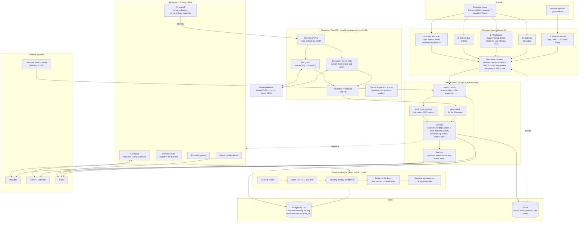
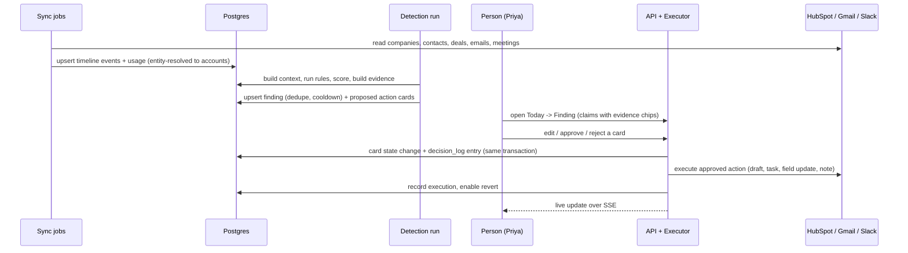
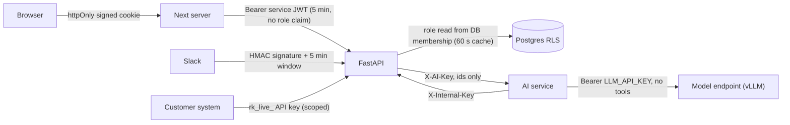
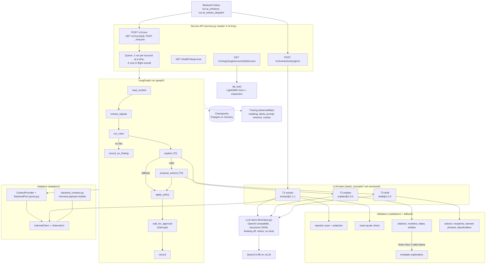
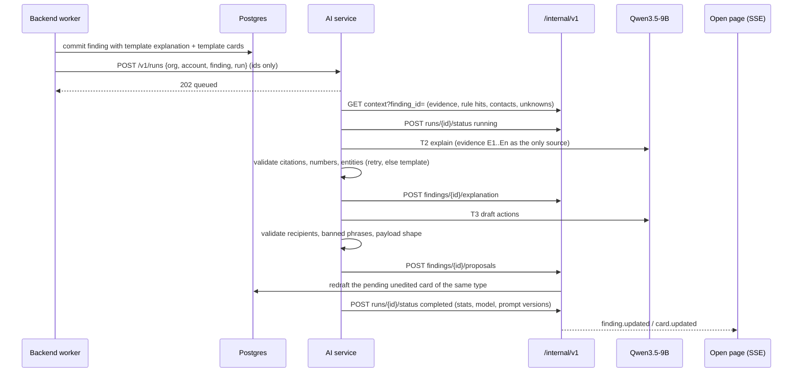
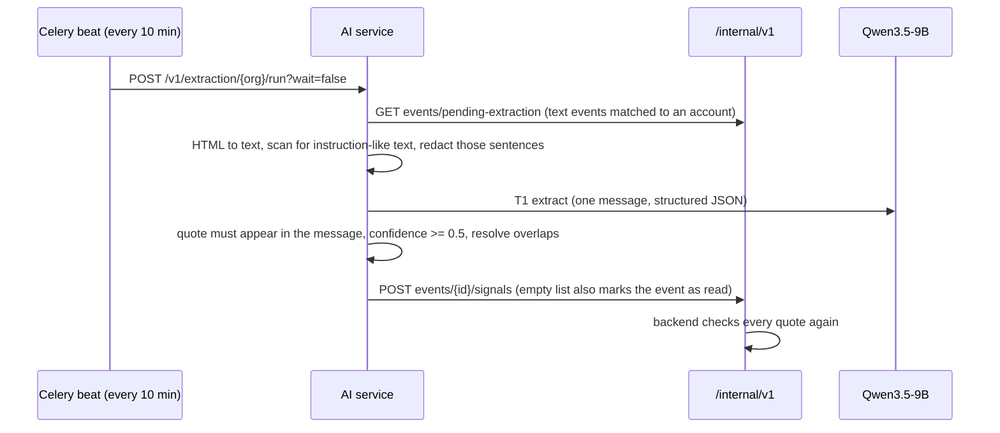

# RevOps Agent: high-level architecture

Written for: you and any new teammate (backend, frontend or the AI engineer). It describes what is
built in the repository today, and marks what is still outside it. If this page and the code
disagree, the code wins.

## 1. The whole platform on one page

## 2. Layers and their one job

| Layer | Where | One job |
|---|---|---|
| Web (Next.js 16, React 19) | `frontend/` | Show the priority list, evidence and approval inbox; never hold secrets or business rules. Gating comes from `GET /me` (`permissions[]`, `flags`, `invitable_roles`). |
| Web server edge | `frontend/src/app/api/*`, `proxy.ts` | Two signed session cookies (customer, admin); mints a 5-minute service JWT per request; forwards `/api/*` to FastAPI unchanged (no mock data); proxies the SSE stream; guards page routes. |
| API (FastAPI) | `apps/api/app` | Contract-first REST, auth, the permission matrix, tenancy, state machines, the decision log. Every endpoint has Pydantic models; an OpenAPI snapshot guards breaking changes. |
| Detection engine | `app/rules`, `app/services/{context,scoring,findings}.py` | Turns raw records into ranked findings with cited evidence. Deterministic and unit/golden tested (30 golden cases). |
| Executor | `app/executor`, `app/connectors/*/writes.py` | Carries out **approved** cards only: idempotent, stores a pre-image, re-checks recipients, supports revert. Tier 3 is blocked in code. |
| Connectors | `app/connectors` | HubSpot, Gmail, Calendar, Slack: OAuth, encrypted tokens (AES-GCM), retries, rate limits, incremental sync. No AI inside. |
| Data | PostgreSQL + Redis | 33 tables, tenant isolation by RLS (`org_id`), append-only hash-chained `decision_log`. |
| AI port | `app/ports`, `/internal/v1`, `app/services/ai_client.py`, `app/workers/tasks_ai.py` | The only door between the backend and the AI service. `AI_MODE=template` (default) never calls it; `AI_MODE=external` hands findings to it after the template result is committed. |
| AI service | `apps/ai` (package `revops_ai`) | Reads emails and notes for signals, rewrites the template explanation in cited prose, and redrafts the action cards. Has no database access and no provider access: everything goes through `/internal/v1`. Details in section 7. |

## 3. The core loop (what happens to one customer)

Invariants that hold everywhere: nothing external happens without a person's approval; every claim
cites evidence ids; recipients must be known account contacts; every decision is logged in the
same transaction as the change; foreign-tenant ids return 404.

With `AI_MODE=external` one step is added after the finding is committed: the AI service upgrades
the explanation and the pending cards (section 7.2). The loop above does not wait for it.

## 4. Trust boundaries

- Customer and admin sessions are separate cookies and audiences; a cookie of one portal is never valid for the other.
- The superadmin has no memberships and sees counts, statuses and error text only, never customer content.
- Provider tokens are encrypted at rest; OAuth `state` is signed, single use and carries only an allow-listed return target.
- Only these endpoints are callable signed out (and rate limited): login, signup, admin login, set-password, invite preview, OAuth callbacks, Slack webhooks, API-key ingest.
- The backend sends the AI service ids only (`org_id`, `account_id`, `finding_id`, `run_id`). The AI service fetches customer content itself from `/internal/v1` and the backend validates every write again. `X-AI-Key` defaults to the same value as `INTERNAL_API_KEY` unless `AI_SERVICE_KEY` is set.
- The model is the only place customer text leaves the two services. It is self-hosted (no third-party AI API), never receives tools or function definitions, and message content is never logged or traced.

## 5. Portals and who enters

| Portal | Routes | Roles |
|---|---|---|
| A. Public and auth | `/login` `/signup` `/invite/*` `/set-password` `/change-password` | everyone |
| B. Onboarding | `/onboarding/*` | Owner/Admin full journey; others Slack, Google and first insights |
| C. Workspace | `/today` `/findings/*` `/inbox/*` `/accounts/*` `/log/*` `/review` `/runs/*` `/team` `/outcomes` | all five customer roles, gated by permissions |
| D. Settings | `/settings/*` | personal pages for all, workspace pages by permission |
| E. Platform Admin | `/admin/*` | platform operator only |
| F. Slack | inside Slack | linked members: digest and Approve / Reject buttons that call the same approve API |

Where AI shows up in the portals: the Finding page labels the summary as rule-based or AI-written
(from `finding.model`), and Platform Admin > LLM shows the real mode, model and probe latency from
`GET /admin/llm/health`.

## 6. Operations and delivery

| Concern | How |
|---|---|
| Environments | Local: docker compose (Postgres 5433, Redis 6379, Mailpit). Staging: `docker-compose.staging.yml` + Caddy. Web: any Node host. AI service: `--profile ai` in both compose files (port 8100); the model runs on a separate GPU host. |
| Migrations | Alembic, additive only; head is `0006`. CI checks models vs migrations and a clean downgrade/upgrade. The AI service has no migrations (LangGraph creates its own checkpoint tables when `CHECKPOINT_DSN` is set). |
| Tests | Backend 834 (disposable containers), web 58 unit tests, 12 browser E2E on a real stack, 30 golden detection cases. AI: 145 offline test functions, 5 live tests (`-m live`), 30 golden accounts, 161 labeled messages, 30 adversarial injections. |
| CI | `ci.yml` (API), `web.yml` (web + E2E), `ai.yml` (ruff, mypy strict, pytest, golden dataset diff, egress check, pip-audit, offline eval smoke). None has run on GitHub yet. |
| Observability | structlog JSON, Sentry hooks with scrubbing, request ids. AI service: per-run trace with node timings, token counts, prompt versions and evidence hash; Langfuse sink is written but has not been run against a Langfuse server. |
| Contract | OpenAPI snapshot -> `docs/endpoints.md`, error codes, mocks, Bruno collection, web types (`npm run gen:api`). The AI service's requests are tested against `tests/snapshots/openapi.internal.json`. |

## 7. AI/ML service (`apps/ai`)

A separate uv project (Python 3.12, package `revops_ai`, entry `revops_ai.main:app`). It never
imports backend code. The rule for the whole service: **the model writes words, it never decides
facts**. Rules, evidence, scoring, tiers and execution stay in the backend; the model only reads
text and phrases what the evidence already says, and every output is checked before it is saved.

### 7.1 Inside the service

| Module | Where | One job |
|---|---|---|
| Service API | `revops_ai/service.py`, `main.py` | Accepts ids, queues runs, exposes health. Starts even when the model or the backend is unreachable. |
| Run graph | `graph/graph.py`, `runner.py`, `state.py` | One LangGraph run per finding. State is JSON only (ids, signals, results), so a run survives a restart from the checkpoint. A node exception ends the run as `failed`; it never crashes the service. |
| LLM tasks | `tasks/extract.py`, `explain.py`, `draft.py` | T1 signals from one message, T2 explanation of one finding, T3 up to 4 proposed actions. Each returns structured JSON validated by a Pydantic schema (`llm/schemas.py`). |
| Prompts | `prompts/<task>.<semver>.md`, `llm/prompts.py` | Versioned files; the highest semver is active, older ones stay loadable for rollback and canary. |
| LLM client | `llm/client.py` | One OpenAI-compatible client for vLLM. Sends `enable_thinking=false`, uses structured output (`LLM_STRUCTURED_MODE`), retries transient errors, and never sends `tools`. |
| Validators | `validation/` | The gate between model output and the backend (section 7.4). |
| Fallback | `fallback/templates.py` | Builds the explanation from evidence labels when the model output cannot be trusted. |
| Evidence | `evidence/engine.py`, `render.py` | Reference copy of rules R01-R11 / X01-X05 for offline work, plus prompt-safe rendering and a conformance check of backend evidence. |
| Adapters | `adapters/` | `ports.py` defines the two seams (where context comes from, where results go). `internal_client.py` + `external.py` implement them over `/internal/v1`; `inprocess.py` implements them on fixtures for tests, evals and the demo. |
| Observability | `observability/` | Run traces (memory, JSONL or Langfuse sink), PII masking, alert checks, prompt-set selection per org for canary. |
| ML | `ml/` | Churn and expansion scoring (section 7.6). |
| Evals | `evals/`, `synth/`, `tests/golden/` | Suites `baseline`, `t1`, `t2`, `t3`, `e2e` with gates, on a deterministic synthetic world (section 7.5). |

In production (`external` mode) the graph does less than the diagram suggests: `extract_signals` is
skipped because T1 runs in the extraction worker, and `run_rules` does not run rules again; it takes
the rule hits and evidence the backend already built for that finding. The in-process rule engine is
used only for tests, evals and the demo UI.

### 7.2 How a finding is upgraded (AI_MODE=external)

- The template result is always committed first, so the product is complete without the AI step.
- If the AI service is unreachable the Celery task retries with backoff; if it stays down, or the model fails, the template result stays. The outcome is recorded in `agent_runs.stats.ai` and never turns a finished run into `failed`.
- If the backend rejects the AI explanation, the service resends the template explanation and reports the rejection in the run stats.
- An AI proposal replaces a pending card only when no person has edited it (`card.redrafted` in the decision log). It passes the same `validate_card_payload` as a user edit, and tiers are decided by the backend policy, not by the AI.
- Runs end after reporting (`AI_WAIT_FOR_APPROVAL=false`). The approval interrupt and `POST /v1/runs/{id}/resume` exist, but the backend does not call resume yet.

### 7.3 How signals are extracted (T1)

Signals feed the deterministic rules on the next detection run (for example a competitor mention
lets the competitor rule fire). A manual "Run agent now" first asks for extraction of that account
and waits up to `AI_EXTRACT_WAIT_S` (90 s). A failed extraction is not marked, so it is retried on
the next pass.

### 7.4 Guardrails

| Risk | Guard | Where |
|---|---|---|
| Prompt injection in a customer email | Instruction-like sentences are found (with homoglyph folding) and redacted before the model sees the text; the event is quarantined and evidence shows only a fixed label | `validation/injection.py` |
| Invented signal | Every signal carries a quote that must be a substring of the message (whitespace-insensitive); weak signals (confidence < 0.5) are dropped | `validation/quotes.py`, checked again by the backend |
| Uncited or invented claim | Every claim must cite existing evidence keys; numbers and dates in the claim must be supported by the cited evidence; unknown emails and entities, speculation and banned language are dropped | `validation/citations.py`, `numbers.py` |
| Too little survives | Fewer than 2 valid claims after a retry -> template explanation marked `needs_review` | `tasks/explain.py`, `fallback/templates.py` |
| Wrong recipient or risky wording in a draft | Recipients only from the account's contact allowlist; banned pricing language and unfilled placeholders are rejected; at most 4 actions; only action types the account can execute | `validation/actions.py` |
| Model takes an action | Impossible by construction: no tools are ever sent, and the service has no provider credentials. It can only propose cards; a person approves and the backend executor acts | `llm/client.py`, tested in `test_a0_hard_rules.py` |
| Contract drift | Payloads validate against mirrored backend models (compared to backend source by AST) and requests against the backend's OpenAPI snapshot | `adapters/backend_contract.py`, `test_a7_external.py` |
| Customer content in logs | Only task name, sizes, latency and token counts are logged; traces are masked; an egress check fails if `LLM_BASE_URL` points at a hosted-LLM vendor or a non-private host without TLS | `observability/tracing.py`, `scripts/egress_check.py`, `test_a8_hardening.py` |
| Overload from a nightly fan-out | Runs are queued, not refused: one per account, `AI_MAX_CONCURRENT_RUNS` (4) overall; a repeated request for the same finding returns `already_running` | `service.py` |

### 7.5 Model, evals and promotion

| Topic | State |
|---|---|
| Model | `Qwen/Qwen3.5-9B`, served by vLLM on a rented cloud GPU, reached through an OpenAI-compatible URL (`LLM_BASE_URL`). Setup scripts and notebooks are in `apps/ai/infra/cloud/`. |
| Offline evals | A deterministic stand-in model (`evals/heuristic_llm.py`) runs all suites in CI without a GPU. These numbers prove the pipeline, validators and gates; they say nothing about model quality. |
| Live gates | T1: precision >= 0.85, recall >= 0.70, JSON validity >= 0.995, injection resistance 1.00. T2: raw citation validity >= 0.90, post-validator 1.00, number fidelity >= 0.98, fallback < 10%. T3: 0 banned phrases, recipients and payloads 1.00. |
| Live results (2026-10-11) | T1 on `extract@1.1.1`: precision 0.890, recall 0.986, JSON 1.0, injection 1.0. T2: citation 1.0, number fidelity 1.0, fallback 0. T3: all gates pass. Details and earlier failing runs: `apps/ai/evals/README.md`. |
| Latency seen | T1 p95 about 6 s, T2 p50 about 18-22 s, T3 p95 about 30 s (T4 GPU, GGUF). |
| Promotion | A prompt, model or quantization change must pass every gate and not regress any gated metric by more than 2 points (`scripts/promote.py`). Then a canary per org (`select_prompts`, `canary_decision`). |
| Alerts | Fallback rate above 20% in one hour; LLM p95 above 20 s (`check_alerts`). Operations: `docs/ai-runbook.md`. |

### 7.6 Churn and expansion scores (ML)

| Topic | State |
|---|---|
| What | Two LightGBM classifiers (churn/downgrade and expansion) with probability calibration, low/medium/high bands and SHAP reasons per account. |
| Data | One row per renewal, features measured 90 days before the renewal date (37 features for churn: usage trend, meetings, replies, champion, signal counts, deal state, plan and segment). Contract: `docs/ml-data-contract.md`. |
| Training | `scripts/train_model.py --task <churn|expansion> [--csv file]`. Time-based split (oldest 60% train, 12% early stopping, 14% calibration, newest 14% test), an unseen-org check, and logistic-regression and rules-score baselines. Artifacts and model cards in `apps/ai/models/`. |
| Serving | `GET /v1/orgs/{org}/accounts/{id}/scores` (also `/churn`, `/expansion`) on the AI service. |
| Status | Trained on **synthetic** data only; the model cards say `production_ready: false`. The backend does not call these endpoints and nothing is shown in the product. On the synthetic data LightGBM does not beat logistic regression. |

## 8. What is outside this repository, or not connected yet

| Item | State |
|---|---|
| AI service (signal extraction, explanations, drafts) | Built in `apps/ai` and wired to the backend behind `AI_MODE=external` (default is `template`). Tested against a fake backend that enforces the OpenAPI snapshot and by `tests/test_ai_integration.py` on the backend side. Not yet run as one full stack on the real model, and the docker images for `ai`, `worker` and `beat` have not been built. |
| Model endpoint | A rotating tunnel on a rented GPU, not a deployment. Staging needs a fixed GPU host. |
| Live end-to-end eval | T1, T2 and T3 pass on the real model; the `e2e` suite has not been re-run on it since the last fixes. |
| Churn / expansion scores | Synthetic data only; not exposed to the product. Needs real renewal history. |
| Approval feedback to the AI run | Resume endpoint exists; the backend does not call it. |
| Frontend AI changes | The Finding page label and the admin LLM page were edited but not type-checked or opened in a browser yet. |
| HubSpot / Google / Slack developer apps | Not created. The connector code is tested against recorded fixtures only. |
| Public deployment, domain, email provider | Not done (`docs/go-live.md`). |
| Google restricted-scope verification (CASA) | Not started; needed before public launch. |
| Phase 2 and 3 features | Outcome tracking, learning from edits, support/billing signals, Salesforce: tables exist for some, behaviour not built. |
