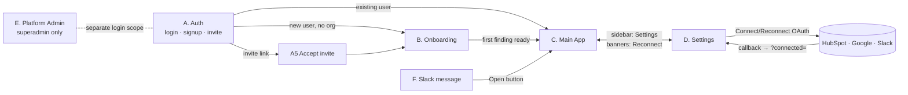
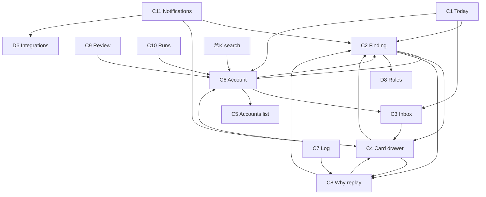

# portals-and-impact.md — Roles, Portals, Pages, Connectivity and Change Impact

> **Purpose:** give the frontend developer the full picture in one place: who can see what, which pages exist in each portal, how pages connect to each other, what fields each page has, how each page behaves, and **what else changes when something changes** (same portal, other portals, external systems like HubSpot/Gmail/Slack).
> Read with: `frontenddeveloper.md` (component specs, validation, API per page), `spec.md` §8 (permission source of truth), `backenddeveloper.md` §5 (API).
> Page IDs (A1, B2, C1, D6, E3…) are the same as in `frontenddeveloper.md`.

---

## 1. The six roles

| # | Role | Who | Lives in | One-line job |
|---|---|---|---|---|
| 1 | **Owner** | Founder / person who created the org | Customer portals | Everything, plus delete org and transfer ownership |
| 2 | **Admin** | IT / RevOps head | Customer portals | Connect systems, manage people, rules, autonomy, data |
| 3 | **Manager** | CS / Sales manager | Customer portals | Oversee team accounts, approve for anyone, tune rules |
| 4 | **Member** | CSM / AM / Sales rep | Customer portals | Work own accounts: review findings, approve own cards |
| 5 | **Viewer** | CRO / finance | Customer portals | Read-only |
| 6 | **Superadmin** | Our own team | Platform Admin portal only | Run the service; **no access to customer email content** |

Roles 1–5 belong to a customer **organization** (a user can be in many orgs with a different role in each). Role 6 is a global flag on the user (`users.is_superadmin`) and is independent of orgs.

## 2. The six portals

| Portal | Prefix | Roles that enter | Layout |
|---|---|---|---|
| **A. Public & Auth** | `/login` `/signup` `/auth/*` `/invite/*` | everyone (not logged in) | Centered card, no sidebar |
| **B. Onboarding** | `/onboarding/*` | Owner, Admin (full); new Member (short) | Stepper layout |
| **C. Main App** | `/today` `/inbox` `/accounts` `/findings` `/log` `/review` `/runs` `/team` `/outcomes` | Owner, Admin, Manager, Member, Viewer | Sidebar + topbar |
| **D. Settings** | `/settings/*` | all (personal pages) + Owner/Admin/Manager (workspace pages) | Sidebar + settings sub-nav |
| **E. Platform Admin** | `/admin/*` | Superadmin only | Separate dark "Internal" layout |
| **F. Slack surface** | inside Slack | Members who linked Slack (+ Manager/Admin/Owner) | Slack messages; deep links into C |

> Portals C and D share one layout and one Next.js route group `(app)`. A, B and E have their own groups. F is not a web UI; the FE only guarantees that deep-link URLs open the right page (see §9).

---

## 3. Access matrix: role × page

Legend: **✓** full · **R** read-only (buttons hidden/disabled) · **own** only own accounts/cards · **—** not visible (route returns 403 page, nav item hidden).

### Portal A / B
| Page | Owner | Admin | Manager | Member | Viewer | Superadmin |
|---|---|---|---|---|---|---|
| A1 Login, A2 Signup, A3 Check email, A4 Auth error | ✓ | ✓ | ✓ | ✓ | ✓ | ✓ |
| A5 Accept invite | ✓ | ✓ | ✓ | ✓ | ✓ | – |
| B1 Create workspace | ✓ (new org) | ✓ (new org) | ✓ (new org) | ✓ (new org) | ✓ (new org) | – |
| B2 HubSpot, B4 Field mapping, B5 Usage, B6 Slack, B7 Invite team | ✓ | ✓ | — | — | — | — |
| B3 Connect Google | ✓ | ✓ | ✓ | ✓ | ✓ | — |
| B8 First sync progress | ✓ | ✓ | R | R | R | — |

### Portal C
| Page | Owner | Admin | Manager | Member | Viewer | Superadmin |
|---|---|---|---|---|---|---|
| C1 Today | ✓ | ✓ | ✓ | ✓ (default filter = me) | R | — |
| C2 Finding detail | ✓ | ✓ | ✓ | ✓ (actions on own) | R | — |
| C3 Inbox + C4 Card drawer | ✓ | ✓ | ✓ (all pending) | own | R (no buttons) | — |
| C5 Accounts list | ✓ | ✓ | ✓ | ✓ | ✓ | — |
| C6 Account detail (all tabs) | ✓ | ✓ | ✓ | ✓ (run now only own) | R | — |
| C7 Decision log, C8 Why replay | ✓ | ✓ (+verify, export) | ✓ | ✓ | ✓ | — |
| C9 Entity review | ✓ | ✓ | ✓ | — | — | — |
| C10 Agent runs | ✓ | ✓ | ✓ | — | — | — |
| C11 Notifications | ✓ | ✓ | ✓ | ✓ | ✓ | — |
| C12 Team (P2) | ✓ | ✓ | ✓ | — | — | — |
| C13 Outcomes (P2) | ✓ | ✓ | ✓ | ✓ | ✓ | — |

### Portal D
| Page | Owner | Admin | Manager | Member | Viewer |
|---|---|---|---|---|---|
| D1 Profile, D2 My connections, D3 Notifications | ✓ | ✓ | ✓ | ✓ | ✓ |
| D4 General | ✓ | ✓ | R | — | — |
| D5 Members | ✓ (incl. transfer ownership) | ✓ (cannot change Owner) | R (list only) | — | — |
| D6 Integrations | ✓ | ✓ | R | R | R |
| D7 Field mapping | ✓ | ✓ | R | — | — |
| D8 Rules | ✓ | ✓ | ✓ | — | — |
| D9 Autonomy | ✓ | ✓ | R | — | — |
| D10 API keys | ✓ | ✓ | — | — | — |
| D11 Data & privacy | ✓ (incl. delete org) | ✓ (export only) | — | — | — |

### Portal E (Superadmin only)
E1 Orgs · E2 Org detail · E3 Jobs · E4 LLM health · E5 Evals · E6 Flags — all ✓ for Superadmin, hidden/403 for everyone else. Superadmin has **no** access to C/D pages of a customer org (no impersonation in v1).

**FE rules**
1. Sidebar items are built from `can(role, 'view:<page>')`; hidden items are never rendered.
2. If someone opens a URL they cannot access: show a **403 page** ("You don't have access. Ask an admin.") — not a blank page, not a redirect loop.
3. Hiding is UX only; the API enforces the same rules.
4. `/me` returns `permissions[]`, `flags{}`, `org.status`; FE derives all gating from it (not from the role string alone).

---

## 4. How portals connect (navigation map)

### 4.1 High-level journey

### 4.2 Page-to-page links inside Portal C

### 4.3 Link table (from → to, with the URL and what is passed)
| From | Control | To | URL / params |
|---|---|---|---|
| C1 Today row | title / "Open" | C2 | `/findings/{finding_id}` |
| C1 Today row | account name | C6 | `/accounts/{account_id}` |
| C1 Today row | "N actions" | C3 | `/inbox?finding={finding_id}` |
| C2 Finding | account link | C6 | `/accounts/{id}` |
| C2 Finding | card row | C4 | `/inbox/{cardId}` (drawer opens over current page) |
| C2 Finding | history entry | C8 | `/log/{logId}` |
| C2 Finding | "Edit rule" (Manager+) | D8 | `/settings/rules#R01_usage_drop` |
| C2 Finding | evidence chip "Open in…" | external | HubSpot/Gmail/Calendar URL (new tab) |
| C3 Inbox row | click | C4 | `/inbox/{cardId}` |
| C4 Card | finding link | C2 | `/findings/{id}` |
| C4 Card | after execute: "Open draft in Gmail" / "Open task in HubSpot" | external | `external_ref` URLs |
| C5 Accounts row | click | C6 | `/accounts/{id}` |
| C6 Account | pending actions | C3 | `/inbox?account={id}` |
| C6 Account | open finding | C2 | `/findings/{id}` |
| C6 Account header | "Open in HubSpot" | external | `crm_url` |
| C6 Usage tab empty state | "Connect usage data" | D6 / B5 | `/settings/integrations#usage` |
| C7 Log row | click | C8 | `/log/{id}` |
| C9 Review | resolve | C6 | after resolve, link "View account" |
| C11 Bell item | click | by kind | finding → C2, card → C4, integration_error → D6 |
| Banner (integration problem) | "Reconnect" | D6 (admin) or D2 (own Google) | `/settings/integrations` or `/settings/connections` |
| D6 Connect button | OAuth | provider → back | return `/settings/integrations?connected=hubspot` or `?error=access_denied` |
| B-steps Connect buttons | OAuth | provider → back | return `/onboarding/{step}?connected=…` |
| Slack message "Open" | link | C4 / C2 / C6 | `WEB_URL/inbox/{cardId}` etc. (auth redirect then back) |
| Topbar org switcher | select org | same page type in other org (or `/today`) | session `orgId` changes; **all queries cleared** |

**Global entry points:** sidebar (C pages + Settings), `⌘K` search (accounts), bell (notifications), integration banner, Slack deep links, email invites.

---

## 5. Page catalogue (what each page contains and does)

Format per page: **Route · Roles · Reads (API) · Key fields · Functionality · Writes/side effects · Connected pages.**
Detailed field validation and component props are in `frontenddeveloper.md`; this section is the connectivity-oriented summary.

### 5.1 Portal A — Public & Auth

**A1 `/login`** · all · — · Email, [Google button] · Google OAuth or email magic link; after login routes: 0 orgs → B1; pending invite → A5; else last org → C1 · Creates session · → B1, A5, C1.
**A2 `/signup`** · all · — · Full name, Work email (free-mail warning), [Google] · same as login; creates `users` row on first login · → B1.
**A3 `/auth/check-email`** · all · — · shows email, Resend (60 s cooldown), "different email" · → A1.
**A4 `/auth/error`** · all · — · error code message · → A1.
**A5 `/invite/{token}`** · logged-in user · `POST /invites/accept` · shows org name, role, invited by, expiry; Accept/Decline; states: expired, used, email mismatch · Accept creates `memberships` row · → B (member short flow) or C1. **Impact:** D5 Members list of that org gains a member; invite disappears from D5 pending list; `member.updated` SSE to admins.

### 5.2 Portal B — Onboarding (stepper; each step saves immediately)

| Step | Route | Roles | Key fields | Functionality | Side effects / impact |
|---|---|---|---|---|---|
| B1 | `/onboarding/org` | any logged-in user without org | Company name, Primary domain, Other domains, Timezone, Currency, Team size | `POST /orgs`; creator becomes **Owner** | Creates org + default rules + default autonomy policies; session `orgId` set; Settings D4 shows these values |
| B2 | `/onboarding/hubspot` | Owner/Admin | [Connect HubSpot] → shows portal name, scopes | OAuth; required | Creates `integrations` row; starts backfill; D6 shows connected; B8 progress; Today fills later |
| B3 | `/onboarding/google` | any member (own) | [Connect Google]; connected email | Per-user OAuth; skip allowed | Starts Gmail/Calendar backfill for that user; D2 shows it; findings stop saying "emails of X not connected" |
| B4 | `/onboarding/field-mapping` | Owner/Admin | Renewal date, ARR, MRR, Seats, Plan, Health field + value mapping, Owner source | Dropdowns from HubSpot properties; preview 3 companies | Writes `field_mappings`; drives account fields, rules R04/R08/X01, write-back target; same as D7 |
| B5 | `/onboarding/usage` | Owner/Admin | API key (shown once) / CSV file + column mapping | Generate key or upload CSV; validate then import; skip allowed | Creates `usage_snapshots`; same as D10 + CSV tool; account Usage tab and R01/X01 get data |
| B6 | `/onboarding/slack` | Owner/Admin | [Connect Slack]; member↔Slack user table; digest time | OAuth + link members | Enables Slack approvals + digest; D2/D3 reflect |
| B7 | `/onboarding/invite` | Owner/Admin | rows: Email, Role | `POST /invites` | Emails sent; D5 pending list; invitees land on A5 |
| B8 | `/onboarding/first-sync` | Owner/Admin (others read) | progress per integration, accounts analyzed | SSE `sync.updated` / `run.updated`; "Open Today" when first finding exists | Onboarding marked complete → future logins go straight to C1 |

New **Member** (invited) short flow: A5 → B3 (Google) → B6-member (link Slack, optional) → C1.

### 5.3 Portal C — Main App

**C1 Today `/today`** · O/A/M/Mem (R for Viewer) · `GET /today` · Fields per row: rank, account, type, severity, title, top reasons+chips, ARR, renewal, owner, pending actions, flags (new/changed/?/⇄), priority score · Filters (type, owner, severity, renewal window); row actions Open / Review actions / Snooze / Dismiss; right panel mini-inbox · **Writes:** snooze, dismiss (→ finding status), quick approve (non-email Tier 2) · **Impact:** dismiss/snooze removes row, updates Accounts risk column, Account overview, log; approve updates Inbox, finding cards, Slack message · Connected: C2, C3, C6.

**C2 Finding `/findings/{id}`** · all (Viewer R) · `GET /findings/{id}` · Fields: header (account, type, severity, status, priority, confidence label, dates, owner), summary, claims+chips, Not confirmed, Signals that disagree, Evidence table (E1…), Rules fired, What changed, Suggested actions (cards), History, Model info (Manager+) · Actions: Run again, Snooze, Dismiss/Reopen, 👍/👎 feedback, card actions inline · **Impact:** dismiss/reopen changes Today, Account, digest; feedback goes to Admin Evals (E5) metrics and Phase 2 rule suggestions; card actions → Inbox, log · Connected: C6, C4, C8, D8.

**C3 Inbox `/inbox`** · O/A/M/Mem (Viewer R) · `GET /action-cards` · Tabs: Waiting for me, All pending (Manager+), Approved, Executed, Failed, Rejected; filters; row fields: type, title, account, severity, tier, created, expires, assignee, status · **Impact:** approve/reject/assign update sidebar badge, Today pending counts, finding card list, account Actions tab, notifications · Connected: C4.

**C4 Card drawer `/inbox/{cardId}`** · same as C3 · `GET /action-cards/{id}` · Common fields (title, account, why + chips, tier, status, assignee, expires, decision info, execution info) + type bodies (email, task, CRM diff, note, Slack, meeting) · Buttons Approve / Save edits / Reject / Assign / Revert / Retry · **Impact (big):** see §6.1 · Connected: C2, C6, C8, external drafts/tasks.

**C5 Accounts `/accounts`** · all · `GET /accounts` · Filters + columns (account, owner, ARR, plan, renewal, risk, expansion dot, usage trend, seats, last activity, CRM health, priority) · Click → C6 · **Impact:** read-only list; changes from C1/C2/D-pages/sync show after SSE or refetch.

**C6 Account `/accounts/{id}`** · all · several `GET /accounts/{id}/*` · Header (name, domains, owner, ARR, plan, seats, renewal, lifecycle, CRM health, last analyzed, Run now); tabs: Overview, Timeline, Findings, Actions, Contacts, Deals, Usage · Actions: Run analysis now (own+), contact role tags (P1) · **Impact:** Run now → new run → finding/cards update across C1/C2/C3 via SSE · Connected: C2, C3, C5, D6.

**C7 Decision log `/log`** · all · `GET /log` · Filters (date, account, event, actor); columns time, actor, event text, account, entity, channel; Admin: Verify integrity, Export · read-only; Export creates a job + `data.exported` log entry.

**C8 Why replay `/log/{id}`** · all · `GET /log/{id}` · timeline: evidence snapshot → rules → AI explanation (+model/prompt) → proposed card → human decision (+edit diff) → execution → revert → outcome; hash chain (collapsible) · read-only.

**C9 Review `/review`** · Manager+ · `GET /entity-reviews` · event, reason, candidate accounts, Assign/Search/Ignore · **Impact:** resolve reassigns events to account (C6 Timeline), adds domain to account (future auto-match), lowers sidebar badge, next run may create/modify findings.

**C10 Runs `/runs`, `/runs/{id}`** · Manager+ · `GET /runs` · account, trigger, status, duration, rule hits, LLM calls, tokens, error; detail = node timings, validation failures, trace link, Retry · **Impact:** Retry starts new run → C1/C2 update.

**C11 Notifications (bell panel)** · all · `GET /notifications` · kind, title, body, time, link; Mark all read · **Impact:** read state only.

**C12 Team `/team` (P2)** · Manager+ · per-member stats; click → C1 filtered by owner.
**C13 Outcomes `/outcomes` (P2)** · all · executed actions with outcome and summary tiles.

### 5.4 Portal D — Settings

| Page | Route | Roles | Key fields | Functionality | Impact summary (details §6) |
|---|---|---|---|---|---|
| D1 Profile | `/settings/profile` | all | Name, Email (ro), Avatar, Timezone, Language | `PATCH /me` | Timezone changes all displayed times for this user and digest time |
| D2 My connections | `/settings/connections` | all | My Google status/scopes/last sync, My Slack link; Reconnect/Disconnect | per-user OAuth | Disconnect stops that user's email/calendar sync → "emails of X not connected" unknown on their accounts' findings |
| D3 Notifications | `/settings/notifications` | all | Digest channel/time/days; instant alerts toggles | `PATCH /me` | Changes Slack digest and bell/email alerts for this user only |
| D4 General | `/settings/general` | Owner/Admin | Org name, Primary domain, Internal domains, Timezone, Currency, Nightly hour, Backfill days, Card expiry days | `PATCH /orgs/current` | Domains → internal/external detection; nightly hour → job schedule; expiry → new cards; currency → money display |
| D5 Members | `/settings/members` | Owner/Admin (Manager R) | table: Name, Email, Role, Status, HubSpot owner, Slack user, Google ✓/✕, Last active; Invite; pending invites; Remove | members + invites APIs | Role/owner mapping changes permissions and what each user sees in C |
| D6 Integrations | `/settings/integrations` | Owner/Admin (others R) | cards for HubSpot, Google (count), Slack, Usage API, CSV; status, label, last sync, last error; Sync now, history, Disconnect | integrations APIs | Status feeds the global banner (all users), onboarding, findings "stale data" unknowns |
| D7 Field mapping | `/settings/field-mapping` | Owner/Admin | same as B4 + Writable CRM fields checklist | `PUT /field-mapping` | Re-derives account fields on next sync; changes what the agent may propose to write |
| D8 Rules | `/settings/rules` | Manager+ | per rule: Enabled, params, Preview, Reset | `PUT /rules/{key}` | Affects findings at next run |
| D9 Autonomy | `/settings/autonomy` | Owner/Admin (Manager R) | per action type: Tier, Locked, Conditions | `PUT /autonomy/{type}` | Affects **new** cards' tiers |
| D10 API keys | `/settings/api-keys` | Owner/Admin | Name, prefix, scopes, last used, Revoke; Create (shown once) | api-keys APIs | Revoke breaks external usage pushes immediately |
| D11 Data & privacy | `/settings/data` | Owner (full) / Admin (export) | Export log (range, format), Export all (P2), Delete org (type name), retention info | log export, org delete | Delete org logs everyone out |

### 5.5 Portal E — Platform Admin (Superadmin)

| Page | Route | Key fields | Functionality | Impact on customer portals |
|---|---|---|---|---|
| E1 Orgs | `/admin/orgs` | org, plan, members, accounts, integration status icons, last nightly run, errors 24 h, created | list + search | none (read) |
| E2 Org detail | `/admin/orgs/{id}` | overview, integrations with errors, recent runs, failed jobs, flags for org, Suspend/Unsuspend | suspend; per-org flags | **Suspend** → customers see "Workspace suspended" page, API 403 `org_suspended`, jobs stop; **flags** change what C/D show |
| E3 Jobs | `/admin/jobs` | queue depths, failed jobs table | Retry/Discard | retry may update C sync status/findings |
| E4 LLM health | `/admin/llm` | model/version, uptime, p50/p95, tokens/min, JSON failure %, citation failure % | read | when unhealthy: customers see "needs review" findings and rule-only explanations |
| E5 Evals | `/admin/evals` | runs: date, model, prompts, metrics vs gates | Run eval | none directly; gates decide model/prompt promotion |
| E6 Flags | `/admin/flags` | key, description, default, per-org overrides (`email_send`, `meeting_request`, `slack_approvals`, `prompt_variant`) | toggle | toggles features in C/D after next `/me` refresh |

### 5.6 Portal F — Slack
- **Daily digest DM:** top items → "Open" opens C2/C1.
- **Approval message:** Approve / Reject / Open. Approve = same as C4 approve (same API); Reject opens a modal for reason; message updates to "Approved by … · Executed ✓ · Revert".
- **Impact:** every Slack decision appears in Inbox, finding, log (channel = `slack`) within a second via SSE.

---

## 6. Change-impact rules (the important part)

How to read: **Trigger → Same portal → Other portals → External systems → Mechanism (what FE must do).**

### 6.1 Action card decisions (most frequent, widest impact)

| Trigger | Same portal (C) | Other portals | External | FE mechanism |
|---|---|---|---|---|
| **Approve** card (C4/C3/C1 panel/Slack) | Card → `approved` → `executing` → `executed`/`failed` (C4 status, C3 row moves tabs); Inbox sidebar badge −1; Today row "N actions" −1; C2 cards list status; C6 Actions tab; C7 Log + C8 entries (`card.approved`, `card.executed`); notification to assignee if failed | **D:** none. **F:** Slack message updated (if card came from Slack). **E:** none (counts only) | Gmail draft created / HubSpot task, note, or field updated | Optimistic status; SSE `card.updated` invalidates `['card',id]`, `['inbox']`, `['today']`, `['finding',fid]`, `['account',aid]`, `['log']` |
| **Edit then approve** | Same + log entry `card.edited` with diff; Why replay shows original vs edited | — | Executed with edited payload | Send `edited_payload` in approve call |
| **Reject** (reason) | Card → `rejected`; leaves "Waiting"; Today count −1; log `card.rejected`; reason stored | Phase 2: feeds draft preferences and rule suggestions (D8 suggestions) | none | Dialog → `POST …/reject`; same invalidations |
| **Assign** | Card moves from my Inbox to new assignee's; notification to new assignee; badge changes for both | Slack ping to new assignee if linked | none | invalidate `['inbox']`; assignee gets SSE `notification.created` |
| **Revert** | Card → `reverted`; log `card.reverted`; C6 Actions tab; if 409 show current vs ours | — | HubSpot field restored / draft or task deleted | Handle 409 `revert_conflict` with explanatory dialog |
| **Expire** (system) | Card → `expired`; disappears from Waiting | notification optional | none | SSE `card.updated` |

### 6.2 Findings

| Trigger | Same portal | Other portals | Mechanism |
|---|---|---|---|
| **Dismiss** (reason) | Finding `dismissed`; row leaves Today; C5 risk column may drop; C6 Overview + Findings tab; pending cards of that finding stay but marked "finding dismissed"; log; 14-day cooldown | Digest (F) will not include it; Admin Evals (E5) uses dismiss reasons as "not useful" signal | invalidate `['today']`, `['finding',id]`, `['account',aid]`, `['accounts']` |
| **Snooze** | Row hidden until date (shows in "Snoozed" filter); reappears automatically; log | digest excludes during snooze | same |
| **Reopen** | Back to Today at proper rank | digest includes again | same |
| **👍/👎 feedback** | none visible except thanks toast | E5 metrics; Phase 2 learning | fire-and-forget |
| **Run analysis now** | Run status chip → new finding version; Today order may change; cards may appear in Inbox | C10 Runs shows new run (Manager) | SSE `run.updated` then `finding.updated`/`card.updated` |
| **New finding created by nightly run** (system) | Today gets new row ("New"); Inbox gets new cards; sidebar badges; C5 risk column; bell notification (high severity) | Slack digest next morning; Slack instant alert if enabled (D3) | SSE `finding.updated` + `notification.created` |

### 6.3 Settings → what changes elsewhere

| Setting changed (page) | Immediate effect (same portal) | Effect in other portals/pages | When | FE mechanism |
|---|---|---|---|---|
| **Role of a member** (D5) | That row updates; log `member.role_changed` | That user's sidebar items, buttons and accessible routes change (C/D); their pending cards stay assigned; if demoted to Viewer, approve buttons disappear | Next `/me` refresh (≤ 60 s cache + JWT 5 min) or immediately on SSE `member.updated` for that user | On `member.updated` for me → refetch `['me']`, rebuild nav; if current page is no longer allowed → 403 page |
| **HubSpot owner mapping of a member** (D5) | Row shows mapped owner | Account `owner_user_id` changes on next sync → C1 Today (member's filter "me"), C5 owner column, C3 default assignee for new cards, digest recipients, Slack approvals recipient | Next HubSpot sync (hourly) or "Sync now" | invalidate `['accounts']`, `['today']` after `sync.updated` |
| **Remove member** (D5) | Row removed; log | Their open cards reassigned to managers; their sessions invalidated (next request 401 → login); their Google integration disconnected; account ownership unchanged until HubSpot owner changes | Immediate | After remove, show summary toast "N cards reassigned" |
| **Invite member** (D5/B7) | Pending invite appears | Invitee gets email → A5 → B3 → C | Immediate | invalidate `['members']` |
| **Org timezone / nightly hour** (D4) | Saved | Nightly job schedule shifts; "Today generated at" timestamp; digest times default | Next scheduled run | none beyond refetch `['org']` |
| **Internal domains** (D4) | Saved | Email/meeting internal-vs-external classification changes for **new** syncs; recompute risk may differ; email recipient allowlist for CC | Next sync | Show warning "Applies to new data" |
| **Currency** (D4) | Saved | All MoneyText across C display the new currency symbol/format (**no conversion**) | Immediate on refetch | Warn: "Values are not converted" |
| **Card expiry days** (D4) | Saved | New cards get new expiry; existing cards unchanged | New cards | none |
| **Field mapping** (D7 / B4) | Saved; preview updates | Account fields (ARR, renewal, seats, plan, health) re-derived after resync → C5/C6 header, C1 priority order, rules R04/R08/X01 results next run; health write-back target changes for future CRM-update cards | Next sync, then next run | Banner "Resync started"; invalidate accounts after `sync.updated` |
| **Writable CRM fields** (D7) | Saved | Future proposals only; existing CRM-update cards using a now-disallowed field are marked `blocked` | Immediately for new; existing re-checked on approve | C4 shows "Blocked by policy" |
| **Rule enabled/params** (D8) | Saved; log `rule.updated`; Preview shows counts | Findings change only at next run: C1 rows may appear/disappear, severity may change, C2 "Rules fired" text changes | Next nightly or "Re-run affected accounts" (button shown after save) | After save: toast "Applies from the next analysis (tonight 02:00) — Re-run now?" |
| **Autonomy tier** (D9) | Saved; log `policy.updated` | **New** cards use new tier (C3/C4 tier badges, whether Tier 1 auto-executes); existing pending cards keep their tier; Slack approval requirement follows tier | New cards only | Info banner "Existing cards keep old tier" |
| **Connect/Disconnect HubSpot** (D6) | Status badge; sync history | Global banner (all users), B8 progress if onboarding, findings "HubSpot data last updated…" unknown, executor can't write (cards fail with `needs_reauth` → bell notification) | Immediate | invalidate `['integrations']`; banner derived from it |
| **Disconnect my Google** (D2) | Status badge | Email/calendar sync for me stops → "emails of <me> not connected" unknown on my accounts' findings, R02/R03 may stop firing; Gmail-draft cards from me can't execute | Immediate | Confirm dialog explains; option "Also delete imported emails" (proposal, needs BE `purge_data`) |
| **Slack connect / link member** (D6/D2) | Status | Slack approvals + digest start for linked members; D3 digest channel options enable | Immediate | invalidate `['me']`, `['integrations']` |
| **API key revoke** (D10) | Row marked revoked | External usage pushes start returning 401; usage freshness stops → Usage tab "last ingest" ages; findings get "usage data stale" unknown | Immediate | Confirm dialog |
| **Usage upload/import** (B5/D10) | Result summary | C6 Usage tab + C5 sparkline + seats; rules R01/R08/X01/X02 next run | Rows visible immediately; findings next run | invalidate `['usage',aid]`, `['accounts']` |
| **Entity review resolve** (C9) | Item leaves list; sidebar badge −1 | C6 Timeline of target account gains the events; account domains updated (future auto-match); findings next run | Immediate for timeline | invalidate `['timeline',aid]`, `['entity-reviews']` |
| **Delete org** (D11) | Confirmation then logout | **All** users of org lose access; jobs stop; data purged after 30 days | Immediate | Redirect to A1 with message |
| **Export log** (C7/D11) | Job progress → download link | log entry `data.exported` | async | Poll job or SSE |
| **Profile timezone** (D1) | Saved | Dates in C/D for this user; digest time interpretation | Immediate | refetch `['me']` |
| **Notification prefs** (D3) | Saved | Slack digest/instant alerts for this user only | Next digest | none |

### 6.4 Superadmin (E) → customer portals

| Trigger (E) | Effect on customers |
|---|---|
| Suspend org (E2) | Every API call for that org returns 403 `org_suspended`; FE shows full-page "Workspace suspended — contact support" (no nav); background jobs stop; Slack buttons reply "Workspace suspended" |
| Unsuspend | Normal again on next request |
| Toggle flag `email_send` (E6) | Email card shows "Will be sent" vs "saved as draft" (C4); Settings text updates |
| Toggle `meeting_request` | Card type appears/disappears in Inbox filter and drawer |
| Toggle `slack_approvals` | Slack buttons appear/disappear; D6 text |
| Change `prompt_variant` for org | Explanations/drafts style may change; C2 Model info shows new version |
| LLM unhealthy (E4) | New findings show "needs review" banner with rule-only summary; no AI drafts; C10 runs show errors |
| Retry/Discard job (E3) | Sync/run states change in D6/C10; may create findings later |
| Run eval (E5) | none for customers |

### 6.5 Data changes from outside the UI (system / external)

| Event | Pages affected | FE mechanism |
|---|---|---|
| HubSpot sync brings new/changed accounts, deals, owners | C5, C6 (header, deals, contacts), C1 order, rules next run | SSE `sync.updated` → invalidate accounts |
| Gmail/Calendar sync brings new events | C6 Timeline, signals badges after T1; R02/R03 next run | SSE `sync.updated` |
| Integration token revoked/expired | Banner on all C/D pages, D6/D2 status red, bell notification | SSE `sync.updated` + `notification.created` |
| Nightly run finishes | C1 (new rows), C3 (new cards), badges, bell | SSE `finding.updated`, `card.updated` |
| Executor fails (provider error) | Card shows Failed + error; bell; Retry (Manager) | SSE `card.updated` |
| Card expires | C3/C4 status | SSE `card.updated` |
| Someone else approves the same card | Your open drawer shows "Already approved by X" and disables buttons (**handle 409 `card_not_pending`**) | SSE `card.updated`; on 409 refetch |
| Role changed by admin while you're using the app | Buttons vanish; actions return 403 | SSE `member.updated`; handle 403 by refetching `/me` |

---

## 7. Realtime events (SSE) — full list the FE must handle

Existing in backend doc: `card.updated`, `finding.updated`, `run.updated`, `sync.updated`, `notification.created`.
**Add (needed by the impacts above):** `member.updated` (role/status/mapping/owner change; payload `{user_id}`), `org.updated` (settings, suspension, flags; payload `{fields}`), `review.updated` (entity review count change).

| Event | Payload | Invalidate / action |
|---|---|---|
| `card.updated` | `{id, status, finding_id, account_id}` | `['card',id]`, `['inbox']`, `['today']`, `['finding',finding_id]`, `['account',account_id]`, `['log']`; update sidebar badge |
| `finding.updated` | `{id, account_id, severity, status}` | `['finding',id]`, `['today']`, `['accounts']`, `['account',account_id]` |
| `run.updated` | `{id, account_id, status}` | run chips on C6/C2; `['runs']` |
| `sync.updated` | `{integration_id, status, stats}` | `['integrations']`, onboarding progress, banner; when `success` also `['accounts']`, `['timeline']` |
| `notification.created` | `{id, kind, link}` | bell count + list |
| `member.updated` | `{user_id}` | if me → refetch `['me']` + rebuild nav/gating; else `['members']` |
| `org.updated` | `{fields: [...]}` | refetch `['org']`, `['me']` (flags/status), field mapping/rules/autonomy lists if relevant |
| `review.updated` | `{open_count}` | badge on Review nav item |

Connection rules: one SSE per browser tab; auto-reconnect with backoff; on reconnect **invalidate everything visible** (events may have been missed); heartbeat every 20 s; stop SSE when tab hidden > 5 min and resume with full invalidate.

---

## 8. Cache / query invalidation cheat sheet

| Mutation (FE call) | Invalidate |
|---|---|
| approve / reject / edit / assign / revert / retry card | `['card',id]`, `['inbox']`, `['today']`, `['finding',fid]`, `['account',aid]`, `['log']`, badge |
| dismiss / snooze / reopen finding | `['finding',id]`, `['today']`, `['accounts']`, `['account',aid]` |
| run account now | `['account',aid]` (run chip), then SSE |
| change member role / mapping / remove | `['members']`, (if me) `['me']` |
| connect / disconnect / sync integration | `['integrations']`, `['org']` |
| save field mapping | `['field-mapping']`, `['accounts']` (after resync) |
| save rule | `['rules']`; show "re-run" prompt |
| save autonomy | `['autonomy']` |
| save org general | `['org']`, `['me']` |
| save profile / notification prefs | `['me']` |
| resolve entity review | `['entity-reviews']`, `['timeline',aid]`, `['account',aid]` |
| create/revoke API key | `['api-keys']` |
| switch org | **clear entire query cache**, reset SSE, route to `/today` |

---

## 9. Role-by-role journeys (what each person sees)

**Owner / Admin:** A1 → B1 → B2 (HubSpot) → B4 (mapping) → B5 (usage) → B6 (Slack) → B7 (invite) → B3 (own Google) → B8 → C1. Later: D6 when banner says reconnect; D5 to manage people; D8/D9 to tune; D11 for exports (Owner: delete/transfer). Owner extra: Settings › Members › Transfer ownership; Settings › Data › Delete org.

**Manager:** A5 (invite) → B3 → C1 (owner = Everyone default) → C3 "All pending" tab → C9 Review badge → C10 Runs when something looks wrong → D8 Rules after reviewing dismiss reasons → C12 Team (P2).

**Member (Priya):** Slack digest → click **Open** → C2 Finding (or C1) → read claims/chips → C4 edit email → Approve → done; Gmail draft appears; she goes to Gmail and sends. Also D2 to connect Google, D3 to set digest time.

**Viewer:** C1/C2/C5/C6/C7 read-only; no approve/edit buttons; no Inbox actions; D1–D3 only.

**Superadmin:** separate login scope → E1 → E2 (investigate org) → E3/E4 (jobs, model) → E5 (evals) → E6 (flags). Never sees emails, evidence text or card payloads (E2 shows counts and errors only).

---

## 10. Edge cases the FE must handle

| Situation | Behavior |
|---|---|
| User opens a page they can't access | 403 page with "Ask an admin"; log nothing |
| Org suspended / deleted | Full-page notice; only "Sign out" |
| Member belongs to 2 orgs | Org switcher; every page URL is org-agnostic (org from session); switching clears cache |
| Integration disconnected mid-use | Banner appears (SSE); actions needing it show disabled with tooltip "HubSpot disconnected" |
| Card changed by someone else while drawer open | 409 → toast "Already <status> by <name>", refetch, buttons disabled |
| Stale CRM preview at execute time | Card becomes `failed` with `stale_preview`; show "HubSpot value changed from X to Y — refresh proposal" + button "Run analysis now" |
| Role downgrade while on a page | Next API call 403 → refetch `/me` → show 403 page |
| Slow nightly run | Today shows "Last analyzed <time>"; stale warning if > 30 h |
| Empty org (no data yet) | Today empty state "Analyzing… first insights in ~10 minutes" with link to B8 |
| Offline/SSE drop | Small "Reconnecting…" pill; on reconnect full invalidate |
| Duplicate click on Approve | Disable button on first click; backend idempotent anyway |

---

## 11. Checklist for the frontend developer

- [ ] Nav + route guards built from `/me.permissions`, with a shared 403 page.
- [ ] One SSE provider; handles all 8 events in §7; full invalidate on reconnect.
- [ ] Mutations use the invalidation table in §8 (put it in `lib/query-keys.ts` as helper functions like `invalidateAfterCardDecision()`).
- [ ] Every Settings save shows **when** the change takes effect (immediate / next sync / next analysis / new cards only) — copy is in §6.3.
- [ ] Org switch clears cache and SSE.
- [ ] 401 → login; 403 → refetch `/me` then 403 page; 409 → refetch + explain; 422 → field errors; 429 → "Slow down" toast; 5xx → retry with backoff and error state.
- [ ] Slack/email deep links work as direct entry after login.
- [ ] Superadmin portal is a separate route group with a separate guard; never reuse customer layout.
