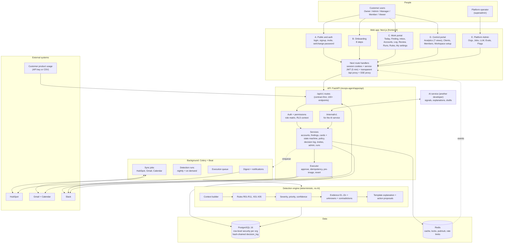
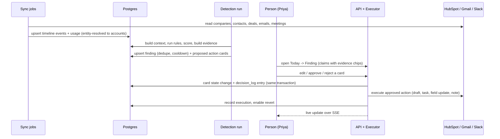
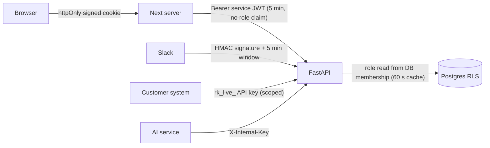

# RevOps Agent: high-level architecture

Written for: you and any new teammate (backend, frontend or the AI engineer). It describes what is
built in the repository today, and marks what is still outside it. If this page and the code
disagree, the code wins.

## 1. The whole platform on one page

## 2. Layers and their one job

| Layer | Where | One job |
|---|---|---|
| Web (Next.js 16, React 19) | `frontend/` | Show the priority list, evidence and approval inbox; never hold secrets or business rules. Gating comes from `GET /me` (`permissions[]`, `flags`, `invitable_roles`). |
| Web server edge | `frontend/src/app/api/*`, `proxy.ts` | Two signed session cookies (customer, admin); mints a 5-minute service JWT per request; forwards `/api/*` to FastAPI unchanged (no mock data); proxies the SSE stream; guards page routes. |
| API (FastAPI) | `apps/api/app` | Contract-first REST, auth, the permission matrix, tenancy, state machines, the decision log. Every endpoint has Pydantic models; an OpenAPI snapshot guards breaking changes. |
| Detection engine | `app/rules`, `app/services/{context,scoring,findings}.py` | Turns raw records into ranked findings with cited evidence. Deterministic and unit/golden tested (30 golden cases). |
| Executor | `app/executor`, `app/connectors/*/writes.py` | Carries out **approved** cards only: idempotent, stores a pre-image, re-checks recipients, supports revert. Tier 3 is blocked in code. |
| Connectors | `app/connectors` | HubSpot, Gmail, Calendar, Slack: OAuth, encrypted tokens (AES-GCM), retries, rate limits, incremental sync. No AI inside. |
| Data | PostgreSQL + Redis | 33 tables, tenant isolation by RLS (`org_id`), append-only hash-chained `decision_log`. |
| AI port | `app/ports`, `/internal/v1`, `docs/ai-integration.md` | The only door for the AI service. Template implementations ship today. |

## 3. The core loop (what happens to one customer)

Invariants that hold everywhere: nothing external happens without a person's approval; every claim
cites evidence ids; recipients must be known account contacts; every decision is logged in the
same transaction as the change; foreign-tenant ids return 404.

## 4. Trust boundaries

- Customer and admin sessions are separate cookies and audiences; a cookie of one portal is never valid for the other.
- The superadmin has no memberships and sees counts, statuses and error text only, never customer content.
- Provider tokens are encrypted at rest; OAuth `state` is signed, single use and carries only an allow-listed return target.
- Only these endpoints are callable signed out (and rate limited): login, signup, admin login, set-password, invite preview, OAuth callbacks, Slack webhooks, API-key ingest.

## 5. Portals and who enters

| Portal | Routes | Roles |
|---|---|---|
| A. Public and auth | `/login` `/signup` `/invite/*` `/set-password` `/change-password` | everyone |
| B. Onboarding | `/onboarding/*` | Owner/Admin full journey; others Slack, Google and first insights |
| C. Work | `/today` `/findings/*` `/inbox/*` `/accounts/*` `/log/*` `/outcomes` `/review` `/runs/*` `/rules` `/team` `/riddhi` `/settings/{profile,connections,notifications}` | Manager, Member, Viewer land here (`/today`); Owner/Admin can switch in. Gated by permissions |
| D. Control | `/control/overview` `/control/analytics/{pipeline,risk,findings,team,automation,data-health}` `/control/clients` `/control/members` `/control/{workspace,integrations,field-mapping,autonomy,api-keys,data}` | Owner and Admin (`analytics:view`); they land on `/control/overview` |
| E. Platform Admin | `/admin/*` | platform operator only |
| F. Slack | inside Slack | linked members: digest and Approve / Reject buttons that call the same approve API |

The customer side has exactly two portals, Work and Control. Which ones a user may enter, and where
they land, comes from `GET /me` (`portals[]`, `home`), derived from permissions in
`app/permissions.py`; the web app never looks at the role name. `/home` forwards to `me.home`.
Old workspace-settings URLs (`/settings/members`, `/settings/rules`, ...) redirect to their new place.
Control analytics are read-only aggregates from `GET /api/v1/analytics/*` (`app/services/analytics.py`),
computed inside the tenant session; nothing is precomputed or stored.

Riddhi, the workspace assistant (`/riddhi`, Manager and above, `assistant:ask`), answers plain-language questions from the same
tables: `GET /api/v1/assistant/catalog` lists the questions, `POST /api/v1/assistant/ask` takes one
of them or typed text. A typed question is matched by keywords to a catalog question
(`app/services/assistant.py::plan_question`), that question runs one fixed read-only query in the
tenant session, and the answer text is built from the query's numbers. A question that matches
nothing is answered with the list of questions that can be asked. With `AI_MODE=external` the AI
service chooses the catalog question for typed text instead (`POST /v1/assistant/plan`); it only
ever returns an id and numbers, which the backend checks, and the keyword match remains the
fallback when the model does not answer. No model writes any part of an answer.
"In the last N days" risk questions read `account_score_history`: one row per account per UTC day
with its highest open risk and expansion score, written at the end of each account run.

## 6. Operations and delivery

| Concern | How |
|---|---|
| Environments | Local: docker compose (Postgres 5433, Redis 6379, Mailpit). Staging: `docker-compose.staging.yml` + Caddy. Web: any Node host. |
| Migrations | Alembic, additive only; head is `0006`. CI checks models vs migrations and a clean downgrade/upgrade. |
| Tests | Backend 834 (disposable containers), web 58 unit tests, 12 browser E2E on a real stack, 30 golden detection cases. |
| CI | `ci.yml` (API) and `web.yml` (web + E2E). Neither has run on GitHub yet. |
| Observability | structlog JSON, Sentry hooks with scrubbing, request ids; Langfuse is reserved for the AI service. |
| Contract | OpenAPI snapshot -> `docs/endpoints.md`, error codes, mocks, Bruno collection, web types (`npm run gen:api`). |

## 7. What is outside this repository, or not connected yet

| Item | State |
|---|---|
| AI service (signal extraction, explanations, drafts) | Another developer. Door is ready: `/internal/v1` + ports. Until then explanations are templates. |
| HubSpot / Google / Slack developer apps | Not created. The connector code is tested against recorded fixtures only. |
| Public deployment, domain, email provider | Not done (`docs/go-live.md`). |
| Google restricted-scope verification (CASA) | Not started; needed before public launch. |
| Phase 2 and 3 features | Outcome tracking, learning from edits, support/billing signals, Salesforce, churn model: tables exist for some, behaviour not built. |
